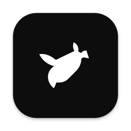
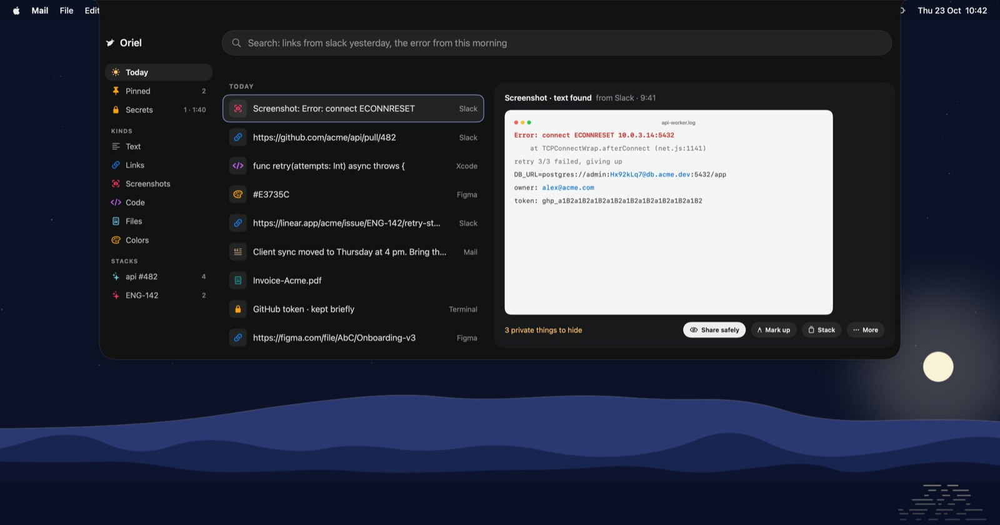
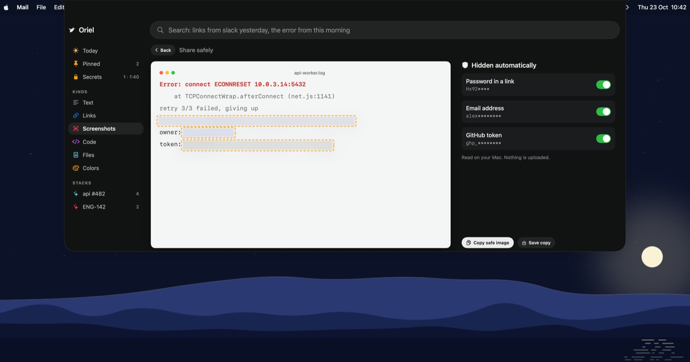
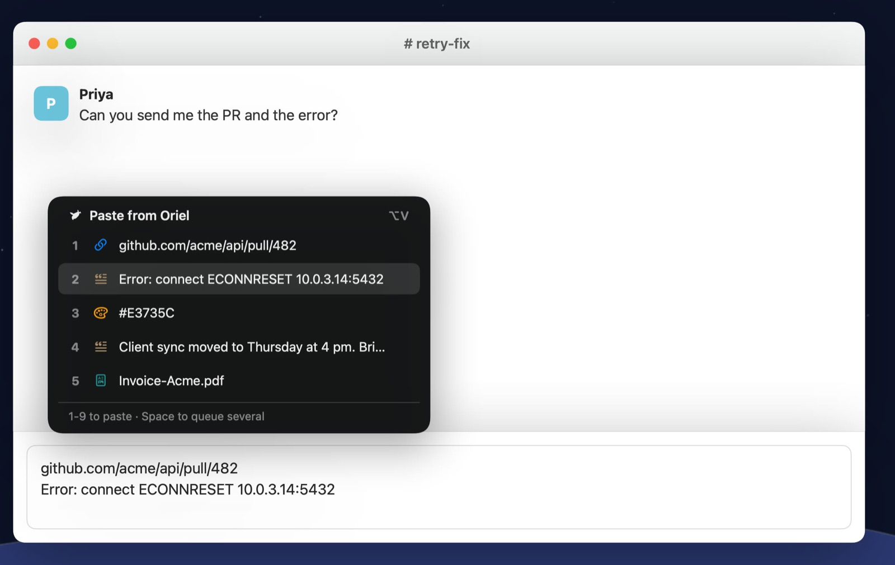
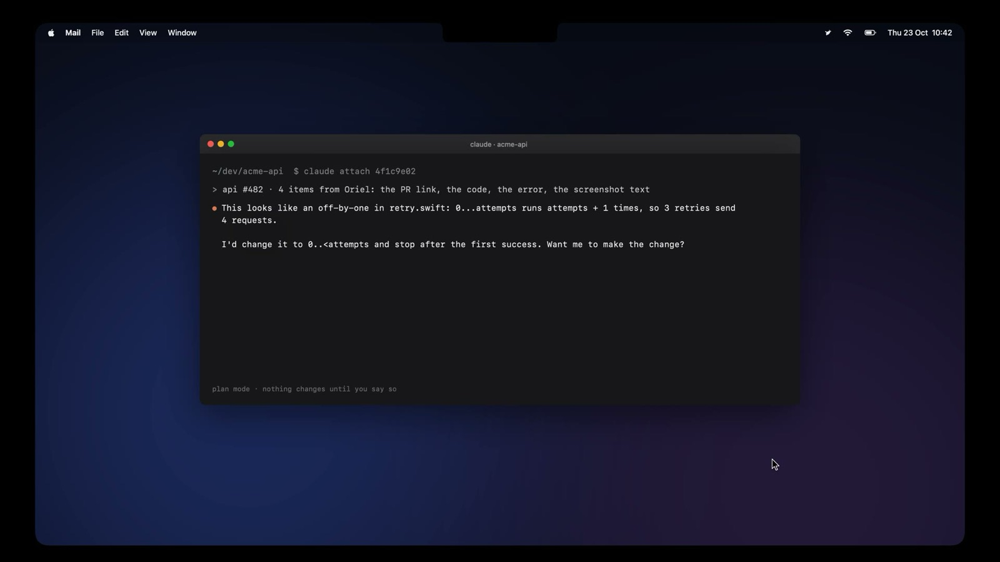

<p align="center">
  
</p>

<h1 align="center">Sill</h1>

<p align="center">
  Everything you copy, in your notch.
</p>

<p align="center">
  <a href="https://github.com/Malaydewangan09/sill/releases/latest"></a>
  <a href="https://github.com/Malaydewangan09/sill/actions/workflows/ci.yml"></a>
  
  <a href="LICENSE"></a>
</p>

<p align="center"><a href="https://malaydewangan09.github.io/sill/">malaydewangan09.github.io/sill</a></p>

Hover the notch (or press ⌃⌥Space) and the shelf opens. Everything stays on your Mac in one SQLite file. Native SwiftUI, no dependencies, ~8 MB universal binary.



[Watch the 25-second demo](docs/sill.mp4)

## What it does

- Copied text and links, new screenshots and new downloads land on the shelf. Text inside screenshots and PDFs is read on the Mac with Vision and PDFKit, so it is searchable.
- Items that share a PR or issue link, a ticket key like `ENG-142`, or a Figma file form a stack on their own. You can make your own stacks too, or turn on *Collect here* to send everything you copy next into one.
- *Hand to Claude* starts a [Claude Code](https://claude.com/claude-code) background session on a stack, in plan mode, in the project's folder. Secrets are masked before anything leaves the Mac. Open the session from any terminal with `claude attach`.
- Search takes plain words: "links from slack yesterday", "screenshot error 3 days ago".
- API keys, tokens, private keys and card numbers are shown masked, never indexed, and forgotten after two minutes.
- *Share safely* finds emails, tokens and passwords in a screenshot and covers them before you share it. *Mark up* adds arrows, boxes, highlights and pixelation.
- Dates become calendar events, meeting links get a Join button, parcels and flights get tracking links.
- *Copy as* converts text: pretty or minified JSON, joined PDF lines, a table as CSV, just the links.

| Share safely | Quick paste |
| --- | --- |
|  |  |

## Keys

| Key | Does |
| --- | --- |
| ⌃⌥Space | Open or close the shelf. Hovering the notch does the same. |
| ⌥V | Quick paste: the last nine items at the cursor. Press 1-9 to paste. Can be turned off in Settings. |
| ⌃⌥T | Grab text: drag over anything on screen and its text goes on the clipboard. |
| ⌘Y | Quick Look the selected item. |
| ⌘Return | Open Share safely or the actions found in the selected item. |
| ⌘Delete | Delete the selected item from Sill. The file it points to stays where it is. |

## Privacy

Sill only keeps what you hand it. It does not read other apps' windows, browser tabs or screen content, and does not track which app you use. There is no network code. The only thing that leaves the Mac is a stack you hand to your own Claude Code.

Permissions:

- Desktop and Downloads (asked by macOS) to index new screenshots and downloads.
- Accessibility (optional) so Quick paste can press ⌘V for you. Without it, Quick paste copies and you paste.

Password managers that mark their clipboard entries as concealed are skipped. 1Password, Keychain Access, Passwords and Bitwarden are excluded by default. Add more in Settings.

Your data is in `~/Library/Application Support/Desk/desk.sqlite`. Delete that folder to start over.

## Install

Requires macOS 14 or later. Download `Sill.dmg` from [Releases](https://github.com/Malaydewangan09/sill/releases), or install from the terminal, which also skips the Gatekeeper step below:

```sh
curl -fsSL https://malaydewangan09.github.io/sill/install | sh
```

To build it yourself you need the Swift 6 toolchain (Xcode 16 or its Command Line Tools).

```sh
git clone https://github.com/Malaydewangan09/sill.git
cd sill
./scripts/bundle.sh
cp -R dist/Sill.app /Applications/
open /Applications/Sill.app
```

The bundle is ad-hoc signed, not notarized, so macOS blocks the first launch of a downloaded copy. Open System Settings > Privacy & Security, click Open Anyway next to Sill, and confirm. On macOS 14 you can also right-click the app and choose Open. macOS asks for permissions again after each rebuild.

## Hand to Claude



Pick a stack and choose *Hand to Claude*. Sill asks once which folder the repo lives in, then runs `claude --bg --permission-mode plan` there with the stack as the prompt. Claude reads and proposes. Nothing changes until you attach and approve. Requires `claude` on your `PATH`.

## Development

```sh
swift build
.build/debug/Sill --selftest
```

[docs/architecture.md](docs/architecture.md) explains how the parts fit. [AGENTS.md](AGENTS.md) has the code rules and privacy rules, for people and coding agents alike. [CONTRIBUTING.md](CONTRIBUTING.md) covers pull requests.

## Status

Experiment, not actively developed. Built on a MacBook with a notch. Screens without a notch get a drawn one.

## License

MIT. See [LICENSE](LICENSE).
